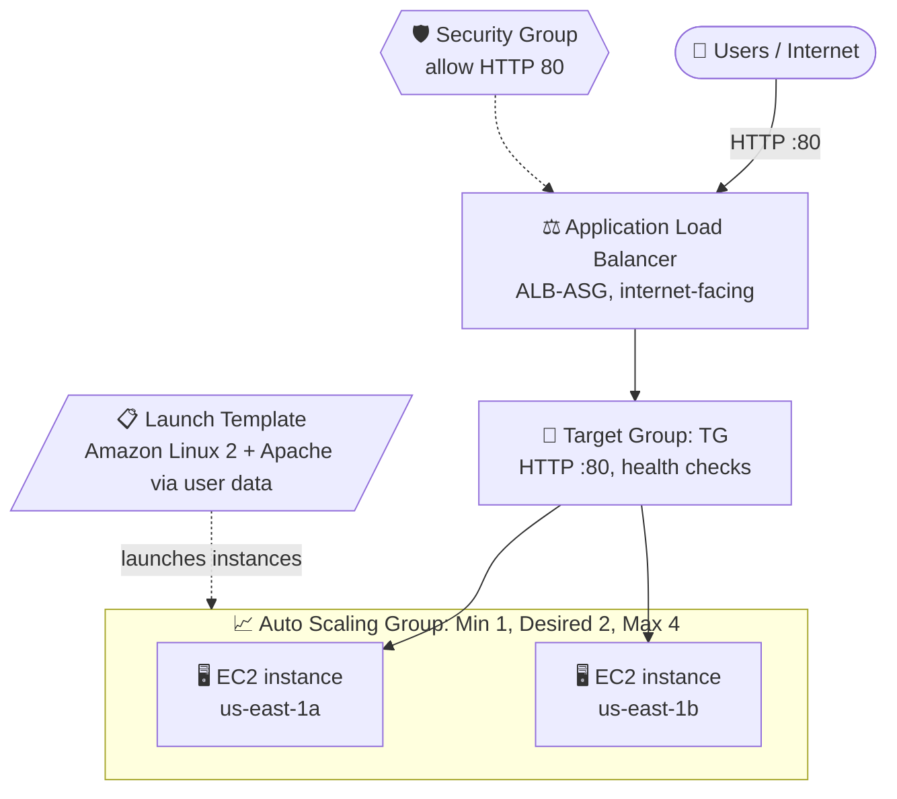

# ⚖️ AWS Lab 5: Application Load Balancer + Auto Scaling Group

### A highly available, self-scaling web tier on AWS
*From Target Group to a live load-balancing test.*

 

 

---

## 📑 Table of Contents

- [🎯 Overview](#-overview)
- [🏗️ Architecture](#️-architecture)
- [🧩 Components](#-components)
- [🛠️ Implementation Steps](#️-implementation-steps)
- [✅ Results](#-results)
- [💡 Key Takeaways](#-key-takeaways)
- [🧹 Clean Up](#-clean-up)
- [📁 Repository Contents](#-repository-contents)

---

## 🎯 Overview

In this hands-on lab I put a web application behind an **Application Load Balancer (ALB)** and let an **EC2 Auto Scaling Group (ASG)** manage the instances behind it. Every instance is launched from a **Launch Template** that installs Apache, registered in the ALB's **Target Group**, and health-checked continuously. Traffic only reaches healthy instances.

| 🔹 Skill practiced | 🔹 How |
|---|---|
| Traffic distribution | ALB spreads requests across instances in different Availability Zones |
| Repeatable deployment | Launch Template builds identical Amazon Linux 2 + Apache servers |
| Elasticity | Auto Scaling Group keeps capacity at **Min 1 · Desired 2 · Max 4** |
| Reliability | Target Group health checks remove unhealthy instances from rotation |

---

## 🏗️ Architecture

---

## 🧩 Components

| # | Component | Key configuration |
|:-:|-----------|-------------------|
| 1️⃣ | **Target Group** | Target type: Instance · Protocol: HTTP : 80 · health checks enabled |
| 2️⃣ | **Security Group** | Inbound HTTP (port 80) allowed, attached to the load balancer |
| 3️⃣ | **Application Load Balancer** | `ALB-ASG` · internet-facing · IPv4 · listener HTTP : 80 → Target Group |
| 4️⃣ | **Launch Template** | Amazon Linux 2 · Apache installed via user data · security group allowing port 80 |
| 5️⃣ | **Auto Scaling Group** | Min 1 · Desired 2 · Max 4 · attached to the Target Group · two Availability Zones |

---

## 🛠️ Implementation Steps

<b>Step 1 · Create the Target Group</b>

Choose target type **Instances**, protocol **HTTP**, port **80**. No instances are registered manually, because the Auto Scaling Group registers them later.

<b>Step 2 · Create the Security Group</b>

Add an inbound rule allowing **HTTP on port 80** so users can reach the load balancer and the web servers.

<b>Step 3 · Create the Application Load Balancer</b>

Create an **internet-facing** ALB named `ALB-ASG`, select subnets in at least two Availability Zones, attach the security group, and add a listener on **HTTP : 80** that forwards to the Target Group. Wait for the state to become **Active**.

<b>Step 4 · Create the Launch Template</b>

Use an **Amazon Linux 2** AMI and the security group from step 2. Add **user data** that installs and starts Apache and serves a page showing the instance hostname, so each instance can be told apart during testing.

<b>Step 5 · Create the Auto Scaling Group</b>

Select the Launch Template, choose the same VPC and subnets, **attach to the existing load balancer's Target Group**, and set capacity to **Min 1, Desired 2, Max 4**.

<b>Step 6 · Verify instances and target health</b>

Confirm the Auto Scaling Group reports **At desired capacity**, that two EC2 instances are running with all status checks passed, and that both targets show **Healthy** in the Target Group.

<b>Step 7 · Test load balancing</b>

Open the ALB's DNS name in a browser and refresh. The page shows the hostname of the instance that answered, and it changes between requests.

---

## ✅ Results

| Check | Result |
|-------|:------:|
| Auto Scaling Group status | ✅ At desired capacity (2 instances) |
| EC2 instances | ✅ 2 running · 3/3 status checks passed · two Availability Zones |
| Target Group health | ✅ 2 healthy · 0 unhealthy |
| Load-balancing test | ✅ Different instances answered the same ALB URL |

> [!NOTE]
> The two test requests returned pages from two different private hostnames (`ip-172-31-4-117` and `ip-172-31-93-48`), which shows the ALB distributing traffic across both instances.

📄 The full step-by-step walkthrough with console screenshots: **[View online](https://github.com/Iman-Naseer/alb-auto-scaling/blob/main/ALB%20%2B%20Auto%20Scaling%20Group.pdf)** · **[Download](https://github.com/Iman-Naseer/alb-auto-scaling/raw/main/ALB%20%2B%20Auto%20Scaling%20Group.pdf)**

---

## 💡 Key Takeaways

- 🔀 An **ALB** gives an application a single entry point and sends traffic only to healthy targets.
- 📋 A **Launch Template** makes every instance identical, so scaling is repeatable.
- 📈 An **Auto Scaling Group** keeps the right number of instances running, scaling out under load and in when idle, so you get availability without paying for idle capacity.
- 🌍 Spreading instances across **multiple Availability Zones** limits the impact of a single-zone failure.

---

## 🧹 Clean Up

> [!WARNING]
> The load balancer and EC2 instances keep billing while they exist. Delete the resources in this order when you finish.

1. Delete the **Auto Scaling Group** (this also terminates its instances)
2. Delete the **Application Load Balancer**
3. Delete the **Target Group**
4. Delete the **Launch Template**
5. Delete the **Security Group** (if it is no longer used)

---

## 📁 Repository Contents

| File | Description |
|------|-------------|
| `README.md` | Project documentation |
| [`ALB+Auto Scaling.jpeg`](ALB+Auto%20Scaling.jpeg) | Summary graphic of the lab |
| [`ALB + Auto Scaling Group.pdf`](https://github.com/Iman-Naseer/alb-auto-scaling/blob/main/ALB%20%2B%20Auto%20Scaling%20Group.pdf) | Step-by-step walkthrough with screenshots |

---

### 🛠️ Tech Used

`AWS EC2` · `Elastic Load Balancing (ALB)` · `EC2 Auto Scaling` · `Launch Templates` · `Security Groups` · `Amazon Linux 2` · `Apache HTTP Server`

 

**Author: Iman Naseer** · [GitHub](https://github.com/Iman-Naseer)

⭐ If you found this useful, consider giving the repo a star.

